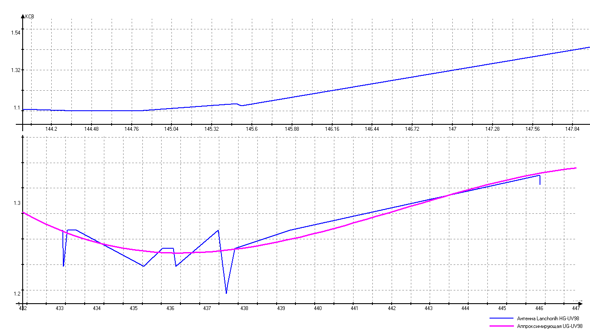

# lanchonlh_hg-uv98_ru_manual

[Lanchonlh HG-UV98 Russian Manual](Menu_Rus_UB3APB.pdf)    
[Lanchonlh HG-UV98 Инструкция на русском](Menu_Rus_UB3APB.pdf)     
[More info & Software...](https://github.com/dkxce/HG-UV98)     
[Прочая информация и софт...](https://github.com/dkxce/HG-UV98)     

  
   


**Экраны APRS**:    
    
    
    
    
    
    
   

**Метео данные**:   

 
**Формат пакета метеоданных HG-UV98**
```
DKXCE-WY>APRS2,WIDE1-1:!0000.00N/00000.00E_087/001g004t059r004p001h89b09799
                                           ^^^ - Направление верта 0-359° - (Direction)
                                              /^^^ - Скорость ветра, м/ч (MPH) - (SPEED)
                                                  g^^^ - Порывы ветра, м/ч (MPH) - (Gust)
                                                      t^^^ - Температура, °F  (Temp)
                                                          r^^^ - Осадки за час, дюймы/100 - (Rain,Hr.)
                                                               p - Осадки за сутки, дюймы/100 - (Rain,24Hr.)
                                                                   h - Оносительная влажность, % - (Humidity)
                                                                      b - Атмосферное давелние, HPa - (Pressure)
```


**Железо**:
| Функция детали | Номер детали  | Комментарий |
|---|---|---|
|Основной MCU | GD32F103RET6 | Архитектура ARM до 108 МГц, 512 КБ флэш-памяти, 64 КБ ОЗУ.
|Основной EEPROM | BL24C256A | 32 КБ I²C EEPROM.
|Дисплей | F0-17HS480-04 | 1,8".
|Аудио усилитель | UTC2822E | Двойной усилитель.
|Приемопередатчик (x2)| AT1846S (RDA1846S) | Кажется, эквивалентно RDA1846S. Он может работать на частотах 134-174, 200-260 и 400-520 МГц.
|TNC MCU | STC 8A8K64S4A12 | Архитектура 8051, 64 КБ флэш-памяти, 8 КБ ОЗУ
|TNC EEPROM | BL24C512A | 64 КБ I²C EEPROM.
|TNC Модем  | CMX865 | FSK (V.23, Bell 202, Bell 103), DTMF / Tone.
|TNC Bluetooth  |HC-02| .. |
|TNC GPS | ZXY1097Z3M3L-18G1200238 (ATGM336H) | ..|
|TNC Датчик | BMP280 | Измеряет температуру, атмосферное давление. |
